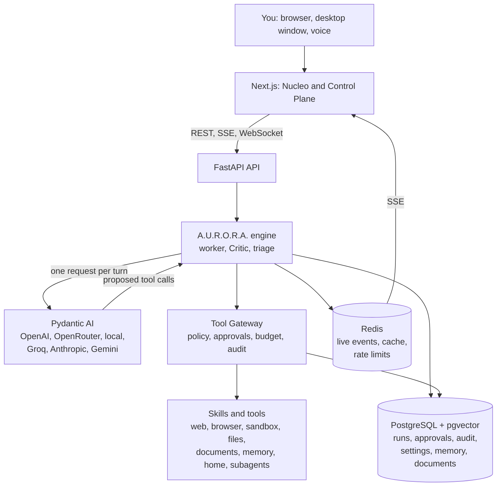

# Architettura di ÆHub

Come è fatto ÆHub: i componenti, la struttura della repository, la memoria e il RAG, i subagenti, l'osservabilità e la sicurezza. Spostato dal README (N10); il motore in dettaglio è in [AEHUB_ENGINE_V1.md](AEHUB_ENGINE_V1.md), le decisioni in [../adr/](../adr/).

## Architecture



### Core components

#### Frontend

The frontend is a **Next.js application** using React, TypeScript and Tailwind CSS. Fonts are bundled from npm, so it loads nothing from third parties.

- **The Nucleo** (`/`, ADR-022) is the home:
  - a dotted sphere in the centre reacts to what the engine does: model calls, tool calls, subagents as small moons, approvals in amber, the microphone, the spoken reply;
  - the conversation sits on the left and the engine's live events on the right; both panes grow from their top edge and can be hidden;
  - pending approvals are decided there;
  - the **RUN** tab of the right pane follows each run of the session (ADR-023): cost, active time, failed tool calls, written files and subagents against the per-run limits, live, with a stop button and the run's timeline; **FERMA TUTTO** in the top bar stops every run (a second click confirms) and **RIPRENDI** lifts the stop;
  - next to the command field a role can be chosen for the next commands (Architect, Research, Fast Worker, Triage); "auto" leaves it to the triage (ADR-029).
- **The Control Plane** (`/control-plane`) has runs, approvals, memory, documents, home, tools, skills, security, voice, settings, system and setup, all in the Nucleo's style; the history of the runs filters by text, status, period and subagents, and shows each subagent under its parent. A run's page lists its subagents, and its timeline shows each verdict of the Critic with the attempt and the correction it asked for (ADR-029).
- **Settings** (ADR-025) choose the LLM of each role (Architect, Research, Critic, Fast Worker, Triage) with its fallbacks, suggesting each provider's models (OpenRouter with prices), and refuse a Critic that shares a model with another role. They also hold keys, default models, the local server, prices, budget and limits, the approval window, the circuit breaker and the context budget, all applied without a restart.
- **Tools and skills** (ADR-026):
  - **STRUMENTI** lists every skill and tool with its risk, approval, network and file access, and whether it returns untrusted content. It switches tools off: a disabled tool is never shown to the agent and is refused if proposed. The page also sets the skill index, the allowed MCP servers and the risk of each MCP tool; it shows what each MCP server answered, with a button to reconnect, and the tools' folders, the API host names and the sandbox.
  - **SKILL** imports skills in the open `SKILL.md` format (Claude Code, Codex, OpenClaw) from an https link (a GitHub page is turned into its raw file) or a file. Only the text is imported, and the skill starts off. The page shows the whole text and flags patterns to check before it can be turned on: download-and-run commands, encoded blobs, instruction overrides, secrets, bundled files and links. The agent reads an enabled skill through the `use_skill` tool as untrusted content, so after reading it every high-risk action waits for an approval.
  - **SICUREZZA** shows the audit hash chain, the log (Control Plane changes included) filtered by decision and tool, and which entries returned untrusted content.
- **SISTEMA** (ADR-030), for the owner only:
  - the state of the database and the event bus, the app's version and uptime;
  - the RAM of ÆHub's processes (backend with voice, PostgreSQL, the browser's Chromium, the desktop window) and the local models in memory (voice and the memory's embedder);
  - whether a newer desktop version is published;
  - the startup parameters, read only, with no password shown;
  - flight recorder search and JSONL export;
  - the offline evals, run in a separate process (the release gate when `evals/baseline.json` is there);
  - rotating the access key (desktop app, keyring), which closes every other session;
  - the backend's recent warnings and errors;
  - links to the API's own pages: `/docs`, `/redoc`, `/openapi.json`, the Prometheus `/metrics` and the `/health` probe (they need no login and answer on the API's host).
  - **The run view** also lists the tools the skill index picked for the run.
- **Home** (ADR-028): the **CASA** page lists your devices with what ÆHub last sent and, on request, what the device says; it adds and edits devices, sets the MQTT broker and tests the connection.
- **Memory and documents** (ADR-027):
  - **MEMORIA** turns long-term memory on or off and sets the similarity threshold, the embedder and its model. After an embedder change it recomputes the old vectors.
  - On the same page you add facts, preferences and rules, search with the engine's hybrid retrieval, and filter by kind and trust. A memory can be edited in place, forgotten, or vouched for ("Mi fido", audited) when it was written from untrusted content. All untrusted memories can be forgotten at once.
  - **DOCUMENTI** shows the working folder and its index. It syncs, uploads a file into the folder, sets the size limit and searches the index.
  - **Citations** `[doc: file#lines]` in answers (Nucleo and run view) open the cited passage.
- **How much of the backend the interface controls** is tracked in `docs/frontend-coverage.md`: 100% since F10. Its index maps every route, setting, startup parameter and secret to the row that covers it, and `tests/security/test_frontend_coverage.py` fails when something new is missing.

The look is a deep-blue space theme with squircle corners. The visual reference is `docs/design/hud-prototype.html`.

The frontend development server is configured to run on port `2003`.

#### FastAPI backend

`backend/main.py` builds the application: routers, the session check on every `/api/` route, the host and origin checks, rate limits, telemetry and, in the desktop app, the static frontend. The API speaks REST, Server-Sent Events (`/api/events`) and a WebSocket (`/ws/orchestrator`) for text and voice commands. The exact list of routes is in `tests/security/test_api_surface.py`.

#### A.U.R.O.R.A. engine

**Autonomous Uplink & Real-time Operations Robotic Assistant** is the project's own execution loop (`backend/app/agent_engine/`), with no agent framework as the authority:

```text
task → triage picks the role
     → worker model: text and proposed tool calls
     → Tool Gateway: each call checked, approved if needed, run, audited
     → observations stored with the run → next turn
     → final answer → Critic (different model) → accepted, or feedback and retry
```

The input of every turn is rebuilt from the run's durable state, so a run can resume after an approval or a crash, or move to a fallback model, without repeating a tool call. Details in [`AEHUB_ENGINE_V1.md`](AEHUB_ENGINE_V1.md).

#### Models

One adapter, `PydanticAIAdapter` (`backend/app/agent_engine/adapters/pydantic_ai_adapter.py`, ADR-032), makes exactly one model request per turn with `pydantic_ai.direct.model_request` and returns the text, the proposed tool calls, the token usage and the response id. Pydantic AI runs no tool: the loop stays A.U.R.O.R.A.'s.

| Provider | Model class | Key |
| --- | --- | --- |
| `openai` | OpenAI Responses API | `OPENAI_API_KEY` |
| `openrouter` | Chat Completions on OpenRouter | `OPENROUTER_API_KEY` |
| `local` | Chat Completions on an OpenAI-compatible server (`AEHUB_LOCAL_BASE_URL`) | none, or `AEHUB_LOCAL_API_KEY` |
| `groq` | Groq | `GROQ_API_KEY` |
| `anthropic` | Anthropic | `ANTHROPIC_API_KEY` |
| `google` | Gemini | `GEMINI_API_KEY` |

Each role has its chain of `provider:model` (Settings, or `AEHUB_MODEL_ROLES`). When a provider fails, a per-target circuit breaker moves the call to the next model of the chain. A provider appears in the role editor once its key is set. LiteLLM is not used.

#### Skills and tools

Skills live in `backend/app/skills/` and expose plain Python functions with metadata: risk (LOW, MEDIUM, HIGH), approval, permissions, network and file access, and whether the output is untrusted. The registry loads every module with a `get_skill()`.

At the start of a run the skill index shows the model only the tools the task names (see [Which tools a run sees](../usage.md#which-tools-a-run-sees)). Skills in the open `SKILL.md` format can be imported from the SKILL page; their text reaches the agent as untrusted content. The MCP client (ADR-033) connects only to the allowed servers, over Streamable HTTP. Each MCP tool is high risk and waits for your approval on every call until you lower its risk on STRUMENTI. Its output is always untrusted, and a server that needs a login gets its token from the keyring (`AEHUB_MCP_TOKENS`).

#### Memory

Long-term memory (`backend/app/memory/store.py`, ADR-027) is scoped to the workspace and the user, not to the login session. Each run recalls what matches its task, by hybrid retrieval (full text and pgvector, fused with Reciprocal Rank Fusion), and runs accepted by the Critic are indexed. See [Memory and RAG](#memory-and-rag).

#### PostgreSQL

PostgreSQL (with pgvector) holds everything durable: identities and sessions, runs and approvals, the hash-chained audit, settings, long-term memory with its vectors and full-text index, the document index and imported skills. The schema comes from the Alembic revisions in `backend/alembic/versions/`, applied at every start (see [Changing the schema](../development.md#changing-the-schema)).

#### Redis

Redis carries the live events (the Nucleo and the Control Plane follow runs and approvals over SSE), the cache and the API's rate limits. It holds nothing durable. The desktop app runs without it: `AEHUB_EVENT_BUS=memory` (or `REDIS_URL=memory://`) keeps events, cache and limits inside the process.

#### External services

Only what you turn on: the model providers you give a key to, DuckDuckGo for web search, the pages the browser tool opens, your MQTT broker, ElevenLabs if you choose it for voice, and GitHub Releases for desktop updates. The voice, the embedder and the database run on this machine.

---

## Project structure

```text
-Hub/
├── backend/
│   ├── main.py              # the FastAPI application
│   ├── desktop.py           # desktop sidecar: PostgreSQL and API on 127.0.0.1
│   ├── alembic/             # schema revisions (ADR-031)
│   └── app/
│       ├── agent_engine/    # A.U.R.O.R.A.: loop, Critic, routing, context, budget, adapter
│       ├── runtime/         # Tool Gateway and audit hash chain
│       ├── api/             # HTTP, SSE and WebSocket routes
│       ├── core/            # database, event bus, cache, security, settings, telemetry
│       ├── skills/          # tools: web, browser, sandbox, files, documents, memory, home, delegation
│       ├── memory/          # long-term memory
│       ├── documents/       # index of the working folder
│       ├── voice/ home/     # local voice; MQTT devices
│       ├── system/          # the SISTEMA page: status, logs, evals, recorder, updates
│       ├── evaluation/      # eval suite and release gate
│       └── domain/models/   # SQLAlchemy models
├── frontend/                # Next.js: src/app (pages), src/components, src/lib, tests
├── desktop/                 # Tauri shell of the Windows app (suspended)
├── tests/                   # backend tests (pytest)
├── evals/                   # run_evals.py and baseline.json
├── scripts/                 # aehub.py launcher, demo.py, check_headers.py
├── docs/                    # ADRs, architecture, configuration, coverage, design
├── config/                  # home.example.json
└── docker-compose.yaml
```

---


## Memory and RAG

### Context Manager and memory retrieval

Every model request of the native engine is assembled by the Context Manager
(`backend/app/agent_engine/context.py`) inside one token budget
(`AEHUB_CONTEXT_BUDGET`, ~88k by default):

| Level | Content |
| --- | --- |
| L0 System | system prompt and tool schemas |
| L1 Task | the goal of the run and the checker feedback |
| L2 Project | the user's trusted preferences and rules |
| L3 Working set | the State Snapshot (Goal / Completed / Failed / Pending) of older tool calls |
| L4 Recent | the latest tool calls and results |
| L5 Historical | memories from earlier sessions, recalled by hybrid retrieval |

Every `AEHUB_SNAPSHOT_EVERY` tool calls the older calls leave L4 and are
summarized in the snapshot. The snapshot is deterministic (no model call) and
never quotes output of untrusted tools. The durable run state keeps every
observation; only the model input is compacted.

### RAG

Long-term memory lives in the `memory_chunks` table
(`backend/app/memory/store.py`), scoped to the workspace and the user, not
to the login session, so a fact saved in one session is recalled in the next.

- Indexing: memory tools (`save_semantic_memory`, `save_procedural_memory`,
  `save_user_preference`) and every run accepted by the Critic, chunked and
  embedded.
- Retrieval: PostgreSQL full-text search (GIN index on `tsvector`) and
  pgvector cosine distance, fused with Reciprocal Rank Fusion, packed into the
  L5 budget at the start of each run.
- Poisoning: anything written while untrusted content (web, files, MCP) is in
  the run context is stored as untrusted. It never becomes a preference or
  rule (L2) and is recalled only inside an untrusted-data fence.
- Control: `GET /api/memory`, `POST /api/memory` (a fact, a preference or a
  rule), `PUT /api/memory/{id}` and `DELETE /api/memory/{id}` let the user
  review, add, edit, vouch for and forget memories.


### Subagents

A run delegates part of its task with the `delegate_task` tool (ADR-029). It goes through the Tool Gateway like any other tool and needs the `agent:invoke` permission, so an admin can delegate and a member cannot. The subagent:

* works with the role asked for (Architect, Research, Fast Worker or Triage), otherwise the one the triage picks, and is checked by the same independent Critic;
* gets at most the tools, permissions and budget of its parent: half of what the parent has left unless it asks for less; when the parent has no run cost cap (`AEHUB_RUN_MAX_COST=0`) it gets the budget it asks for, 1 USD by default;
* starts tainted when its parent has read untrusted content, and its answer is untrusted for the parent;
* cannot delegate again, and a run starts at most `AEHUB_RUN_MAX_SUBAGENTS` of them;
* costs its parent what it spent, even when it fails.

A subagent that needs an approval waits on its own: the parent is told and goes on.


---

## Observability

- **Live events.** Every step of a run (model calls, tool calls, approvals, subagents, the Critic's verdicts) is published on the event bus and streamed over SSE:

  ```text
  GET /api/events                    events of the login session
  GET /api/events?scope=workspace    run states and approvals of the whole workspace
  ```

  The Nucleo draws them live; the Control Plane pages re-read their data when a run changes state or an approval is requested or decided, instead of polling.
- **Run timeline.** `GET /api/runs/{id}/events` returns the recorded steps of one run, shown on its page.
- **Flight recorder.** Every event is also written to a JSONL file, searchable and exportable from the SISTEMA page.
- **Logs.** Structured JSON logs; the latest warnings and errors are on the SISTEMA page.
- **Tracing and metrics.** OpenTelemetry instruments FastAPI and SQLAlchemy (spans are printed on the console unless `AEHUB_TELEMETRY_CONSOLE=0`); Prometheus metrics are at `/metrics`.

---

## Security

The model is treated as untrusted; the engine and the Tool Gateway hold the authority. In short:

| Layer | What it does |
| --- | --- |
| Login | One owner, one access key (`AEHUB_SECRET_KEY`); an HttpOnly session cookie is the only credential. The key can be rotated from SISTEMA, which closes every other session. |
| Network | Every port on `127.0.0.1`; loopback host names only; state-changing requests only from the frontend's origin; rate limits per user (API, model calls, uploads). |
| Tool Gateway | Policy, argument guardrails (SSRF, paths, dangerous commands), schema, idempotency, budget, approval and audit before every call; secrets redacted from the output. |
| Approvals | HIGH-risk calls wait for the owner, in the Nucleo or on the Approvals page; undecided ones are denied after `AEHUB_APPROVAL_TTL_SECONDS`. After untrusted content, and for voice commands, every HIGH-risk call needs one. |
| Untrusted content | Web pages, files, MCP output and imported skills reach the model inside an `<untrusted_tool_output>` fence. Memories written after reading them are untrusted and never become preferences or rules. |
| Guardrails | Prompt-injection patterns in user text are refused; answers have secrets removed. CI runs a prompt-injection gate. |
| Sandbox | Python and shell run in Docker with no network, a read-only root, a memory, CPU and process limit, and no capabilities. |
| Audit | A hash chain in PostgreSQL of every tool call and every Control Plane change; the SICUREZZA page verifies it. |
| Secrets | In the OS keyring, never in the database or in logs; the interface writes keys but never shows them again. |

The threat model is in [`docs/security/threat-model.md`](../security/threat-model.md).

---
